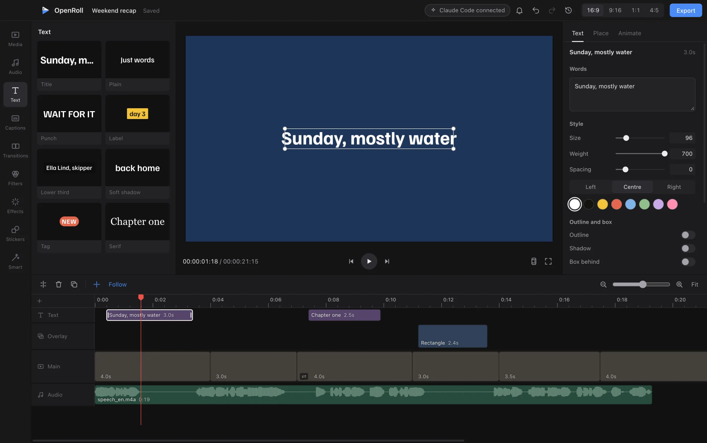

<p align="center">
  
</p>

<h1 align="center">OpenRoll</h1>

<p align="center">
  A free video editor for macOS, Windows and Linux.<br>
  No account, no watermark, and nothing leaves your computer.
</p>

<p align="center">
  <a href="https://github.com/noah-thing/openroll/releases/latest"><b>Download</b></a>
  &nbsp;·&nbsp;
  <a href="#features">Features</a>
  &nbsp;·&nbsp;
  <a href="docs/AI.md">Edit with AI</a>
  &nbsp;·&nbsp;
  <a href="CONTRIBUTING.md">Contribute</a>
</p>

<p align="center">
  <a href="#download"></a>
  <a href="LICENSE"></a>
  <a href="https://x.com/fsconfig"></a>
</p>

<p align="center">
  <a href="https://x.com/fsconfig">
    <picture>
      <source media="(prefers-color-scheme: dark)" srcset=".github/readme/made-by-dark.svg">
      
    </picture>
  </a>
</p>

<p align="center">
  
</p>

OpenRoll is built for the edits people make every day: cutting a vlog, captioning a short, putting music under a trip. It has the tools of a paid editor, captions, background removal, beat cuts, vertical reframing, and runs all of them on your own machine. Projects are plain files you own. Exports never carry a watermark.

## Features

- **Timeline.** Magnetic main track, ripple and roll edits, slip, markers, J K L shuttle and a shortcut for every common action. Playback holds 60 fps on 4K and phone footage.
- **Captions.** Speech to text runs on your computer, with word by word highlights, styles, and SRT or VTT export. Smart cut removes silences and filler words in one step.
- **Sound.** Noise removal, voice enhance, loudness to the social standard, music that dips under speech, beat detection, voiceover and text to speech.
- **Look.** 24 filters, 22 effects, LUTs, curves, HSL, masks, green screen, keyframes on any value and transitions.
- **Smart tools.** Background removal, stabilising, auto reframe for vertical video, smooth slow motion and upscaling, all running locally.
- **Formats.** Long video to shorts, picture in picture, split screen, stickers and safe zones for TikTok, Reels and Shorts.
- **Export.** MP4 (H.264 or HEVC), WebM, ProRes 422 and 4444, GIF, M4A, WAV and stills, in the background while you keep editing.
- **Edit with AI.** Claude Code, Codex, Cursor and other MCP tools can edit the open project with you. Every change shows live and undoes like your own. See [docs/AI.md](docs/AI.md).

## Download

Get the latest build from [Releases](https://github.com/noah-thing/openroll/releases/latest).

| System | File |
| --- | --- |
| macOS, Apple silicon | `OpenRoll-<version>-mac-arm64.dmg` |
| macOS, Intel | `OpenRoll-<version>-mac-x64.dmg` |
| Windows | `OpenRoll-Setup-<version>-win-x64.exe`, or the portable `.exe` |
| Linux | `.AppImage`, or `.deb` for Debian and Ubuntu |

Updates install quietly in the background, and every download is checked against the release's `SHA256SUMS.txt` first. You can turn automatic updates off in Settings.

The builds are not signed with a paid certificate yet, so the first launch needs one extra step:

- **macOS:** open OpenRoll once and close the warning, then go to System Settings, Privacy and Security, and click Open Anyway.
- **Windows:** if SmartScreen appears, click More info, then Run anyway.
- **Linux:** make the AppImage executable (`chmod +x`) and run it.

## Building from source

Requires Node.js 22 or newer.

```sh
git clone https://github.com/noah-thing/openroll.git
cd openroll
npm install
npm run ffmpeg     # fetch the ffmpeg build for this system
npm run dev        # run with live reload
```

Tests, packaging and the code style are in [CONTRIBUTING.md](CONTRIBUTING.md).

## How it works

- **Engine.** Media is decoded with WebCodecs through [Mediabunny](https://mediabunny.dev), on the hardware decoder when there is one. A WebGL2 compositor draws every frame in a worker, so the interface never waits on video.
- **Clock.** Audio drives playback time. Video follows it and drops a frame rather than drift.
- **Projects.** A project is one JSON file. Times are integer microseconds, and every edit is a pure function from one project to the next, which is what makes undo exact.
- **Export.** The exporter renders the same scene as the preview, so what you see is what you get. Formats WebCodecs cannot write go through a bundled ffmpeg.

## Licence

OpenRoll is free software under the [GNU General Public License v3.0 or later](LICENSE). Bundled components and their licences are listed in [THIRD_PARTY_NOTICES.md](THIRD_PARTY_NOTICES.md).
